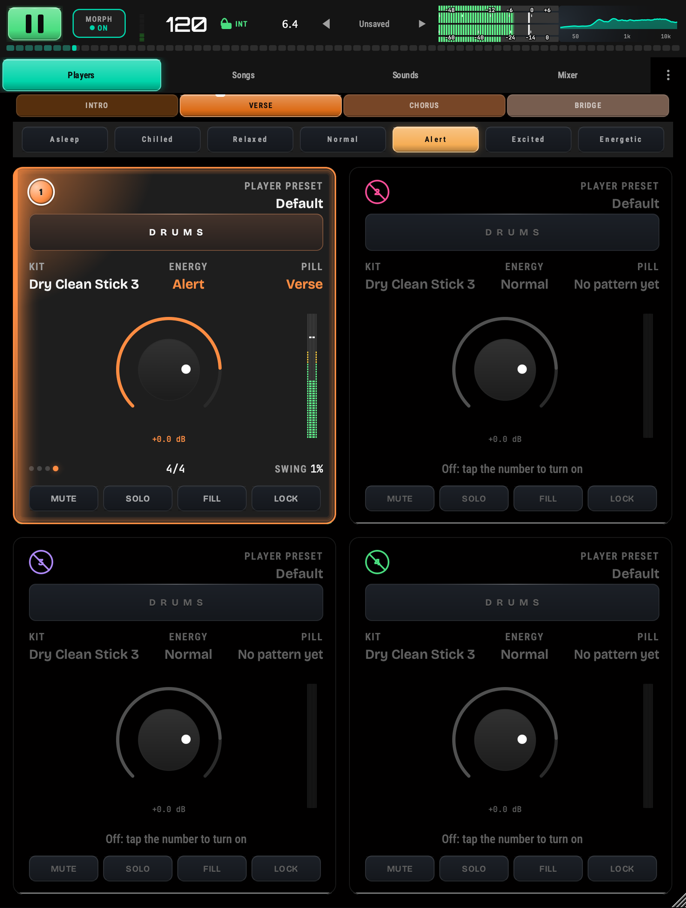

> Temporary quick-start for TestFlight testers until the tutorial videos are ready.

## Thank you for testing

I'm Larry Seyer. Thank you for trying Larry Seyer Drums while it is still a beta.

This guide is a stand-in for the tutorial videos I'm still making. It is meant to get you playing quickly, show you where the main features live, and warn you about a few things that are unfinished in this build. It is not the finished teaching series. When those videos are ready, they will be the standard way people learn the app.

If something in here doesn't match what you see on screen, trust the app in front of you and [tell me](17-how-to-report-problems.md).

Please send feedback by Monday, December 7.

## What Larry Seyer Drums is

Larry Seyer Drums is a complete drum instrument — I call it The Drum DAW — built around real drumming.

You can run up to four players at once. Each player has its own kit, its own part, and its own mix, and they all share one transport. You can write and arrange a song inside the app, play the sounds live from pads or an e-kit, or load the app as a plug-in inside a host and let that host run the session.

The sounds come from the complete Larry Seyer Acoustic Drum Library. Pat Mastelotto played the drums, and I recorded them. A feature called Morph blends neighboring recordings so no two hits sound exactly alike.

“Seyer” is pronounced *Sire*.

## What's in this beta

This TestFlight build is **fully unlocked**. You will not go through a trial, a purchase or an unlock step. That's deliberate, so you can test the whole app.

You can use:

- the standalone app on Mac, iPad and iPhone
- the AUv3 plug-in that comes with that app, inside a compatible host

The full sound library is already in the app. Nothing else downloads later, and it plays offline.

Windows and Linux versions come later. They are not part of this beta.

## What's not in this beta

A short list, so you don't go looking for something that isn't here yet:

- VST3, CLAP and the installer AU plug-in are not in this TestFlight build. This beta is the standalone app plus AUv3.
- There is no trial or purchase flow to test. This build is already unlocked.
- Kit Packs are planned for summer 2027. They are not available yet.
- The Sounds page may still change. The chapter on kits and Morph is written from the current app, and I've marked it as provisional.
- A few other unfinished items are collected in [Known Gaps in This Beta](16-known-gaps.md).

## How the app is organized

When you open the standalone app, a short splash is followed by **Quick Pick**. That is the first screen on purpose. You see a list of **Beats**, a list of **Kits** (those are player presets), and a button labelled **Edit in Full App**. The header reads “Quick Pick is free forever” when the window is wide enough, or “Quick Pick” when it isn't. The line at the bottom shows the beat and kit you have selected, joined with a plus sign.

A fresh installation highlights **Pretty Shuffle** and **Dry**. You can tap any beat and any kit -- there are ten of each, so a hundred pairings -- and hear that combination. Quick Pick remembers the last pair you chose and the tempo you played it at.

**Edit in Full App** leaves Quick Pick and takes you to the **Players** page, where you can edit whatever you want. You are not limited to the ten Quick Pick beats. On the **Songs** page you can add more phrases, start a new empty song, and drag sections onto the timeline. See [Quick Pick and Your First Groove](03-quick-pick-and-first-groove.md).

Four main pages sit along the top of the full app: **Players**, **Songs**, **Sounds** and **Mixer**.

- **Players** is the front of the instrument: four cards, energy, and the transport.
- **Songs** is where you arrange a groove on a timeline by placing pills (phrases) on each player's lane.
- **Sounds** is where you choose and shape kits.
- **Mixer** is the console and the effects.

The Pattern Editor opens from a song pill when you want to change the notes themselves.

A plug-in window is different: a Mac or desktop host opens the full app pages, not Quick Pick. The compact AUv3 window on iPhone and iPad is a Quick Pick view, described in [Using the Plug-in in a Host](12-using-the-plugin.md).

App Settings, keyboard shortcuts, import and export, and a way back to Quick Pick, all live in the **three-dot menu**.

## If you only have a few minutes

1. Open the standalone app. After the splash, Quick Pick appears. Try a beat -- **Busy Beat** is a good one -- and a kit, and listen.
2. Press **Edit in Full App**. You'll land on the Players page, with that groove as a song you can already edit.
3. If you hear nothing, use the [“No sound?” checklist](02-getting-started.md#no-sound-checklist).
4. When you're ready to build something of your own, go to [Your first groove](03-quick-pick-and-first-groove.md#build-your-own-song) and drag pills onto the timeline. You are not limited to what Quick Pick offers.

Then come back and read whatever chapter matches what you want to try next.

---

[Index](index.md) · [Next: Getting Started and Getting Sound](02-getting-started.md)
