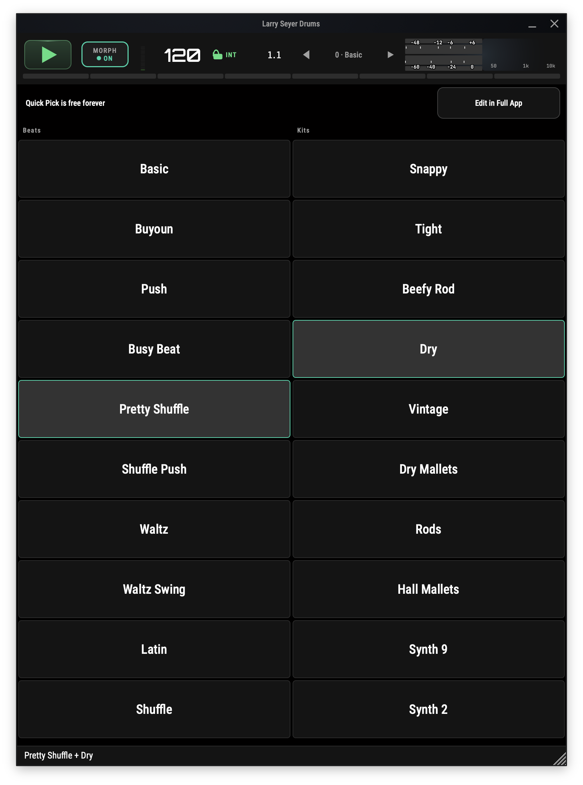
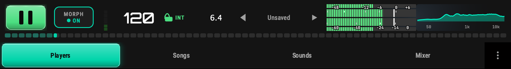

> Temporary quick-start for TestFlight testers until the tutorial videos are ready.

## First launch

On a fresh launch of the **standalone** app you'll see a short splash, then **Quick Pick**. That's the first screen on purpose: you can be hearing drums in a few seconds, before you learn the rest of the app.

You'll see **Beats** on one side and **Kits** on the other (those are player presets). A fresh installation highlights **Pretty Shuffle** and **Dry**. Tap a beat and a kit to hear that pairing. **Busy Beat** is the example I'll use in later chapters; the list labels it **Busy Beat**.

When you're ready for the full app, press **Edit in Full App**. You'll land on the **Players** page, and you can edit whatever you choose from there -- players, the song, kits, the mixer, or a new song of your own. You are not limited to the Quick Pick list.

Next time you open the standalone app, Quick Pick appears again as long as **Show Quick Pick at startup** is on. That switch lives in App Settings, and it is on unless you turn it off. If you turn it off, the app opens on the last song instead of Quick Pick.

You can also reopen Quick Pick from the three-dot menu, or with the Q key if you have a keyboard and you're using the default Larry Seyer Drums key scheme.

A plug-in window in a Mac or desktop host opens on the full app pages, not on Quick Pick. The compact AUv3 window on iPhone and iPad *is* a Quick Pick view, with **Open full Larry Seyer Drums** to attach the app -- that's covered in [Using the Plug-in in a Host](12-using-the-plugin.md).

## The top bar

The top bar is the same idea on every device, with a slightly tighter layout on an upright iPhone.

Here's what you'll use all the time:

- **Play / Stop** and the **DSP load meter** beside it. The meter climbs from green toward red as the device works harder, and it flashes red after a dropout. On iPhone and iPad, watch this when you add effects. See [iPhone and iPad](13-iphone-and-ipad.md).
- The **MORPH** chip. It only reports the state of a feature called Morph: On, Off or Building. It isn't the place you turn Morph on and off. That lives in App Settings, and in the [Sounds](09-sounds.md) chapter.
- **Tempo**, from 30 to 300 BPM, with a lock and a source tag such as INT. A closed lock means the app is following a clock (for example Ableton Link or a host). An open lock means you own the tempo.
- The play position as **bar.beat**, and the beat progress bar for the selected player's pattern.
- The **master meter**. Tap it to switch between dB and LUFS. Tap the spectrum to open the full-screen master.
- The inbound **MIDI** light, which flashes when notes or controls are arriving.
- The **current song** readout, shown as bank:slot and name, with the song stepper.

On an upright iPhone the top bar is tighter. You still get Play, the DSP meter with the MIDI light, tempo plus the lock, the song block and the spectrum. There is no MORPH chip or master meter in that compact bar, and you'll see a compact position and clock line instead. In landscape it becomes a slim bar.

The four **page tabs** — Players, Songs, Sounds, Mixer — sit in this area, along with the **phrase tabs** (five song sections at a time). Tap a phrase tab to jump. A beat arc on the playing tab shows you where you are.

The **energy row** sits with the players: Asleep, Chilled, Relaxed, Normal, Alert, Excited, Energetic. That's a later chapter. You can already tap it and hear the groove change.

> **Screenshot needed:** The upright iPhone top bar, so testers can see how it differs.

## The three-dot menu

The three-dot menu is the front door for almost everything that isn't on the page in front of you: About, Quick Pick, App Settings, Keyboard Shortcuts, then the preset groups (Song, Player Presets, Pattern Presets, Sounds Presets, Mixer Presets, Channel Presets), then Import and Export.

The menu opens on the group for the page you're on. A command that doesn't apply is left out, not greyed off. **Save** appears only on items you created yourself. **Save As** is how you make your own copy.

I'll come back to saving in [Saving and Backups](15-saving-and-backups.md). The short version is: **Save is what makes an edit permanent.**

## Getting sound the first time

In the standalone app, sound should come out of the device's default output. If you need to pick a different interface, open the three-dot menu → **App Settings** → **Audio**.

- **Output Device** can be set to System Default, which follows the computer's output, or to a specific interface.
- Set the sample rate and buffer size to something your device is happy with. On iPhone and iPad, buffer size is 128 to 1024.
- **Test Output** is there if you want a quick confirmation that audio is reaching the device.

If you're inside a host, the host owns the audio device. There is no audio-device page in the plug-in. Make sure the host track is enabled and its output is going somewhere you can hear.

## No sound? checklist

Work down this list, in order. It solves almost every silent first launch.

1. **Is the transport playing?** Press Play. If you're in a host, press Play in the host — the plug-in follows the host by default.
2. **Is there something to play?** On the Songs page, a player only makes sound from the arrangement when a pill covers the playhead. An empty New Song is silent until you place a pill or send it notes from outside. Quick Pick always has a beat ready.
3. **Is the player switched on?** On the card, tap the player number to turn it on if it's off. A slash on the badge means that player is off.
4. **Are the MIDI channel and Input Layout right?** If you're sending notes from pads, an e-kit or a host, the player has to be listening on that channel, and **MIDI Input Layout** (in App Settings, and next to Record in the Pattern Editor) has to match what you're sending: GM, EX or E-Kit. A fresh install starts on GM. If nothing is arriving, check the inbound MIDI light in the top bar.
5. **Is something muted or soloed?** Check Mute and Solo on the player card, mute on a pill, and Mute or Solo on mixer strips. If any strip is soloed, the others are dimmed.
6. **Where is the output going?** In the standalone app, confirm the audio device. In a host, confirm the track output and, if you turned on multi-out, that those extra outputs are actually enabled in the host and routed to something you can hear. See [Using the Plug-in in a Host](12-using-the-plugin.md).

If it's still silent after that, send me a report with your device, system version, and whether you were in the standalone app or a host. [How to Report Problems](17-how-to-report-problems.md) lists what to include.

---

[Previous: Welcome](01-welcome.md) · [Index](index.md) · [Next: Quick Pick and Your First Groove](03-quick-pick-and-first-groove.md)
