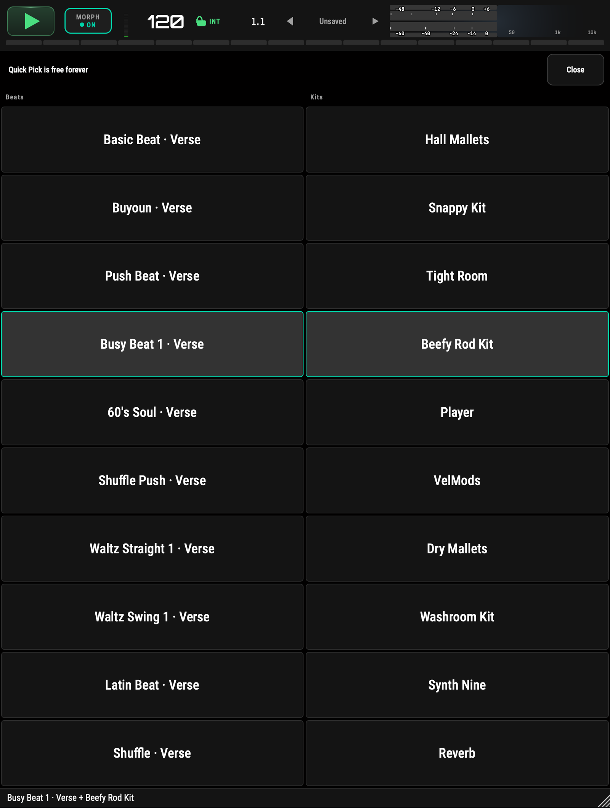
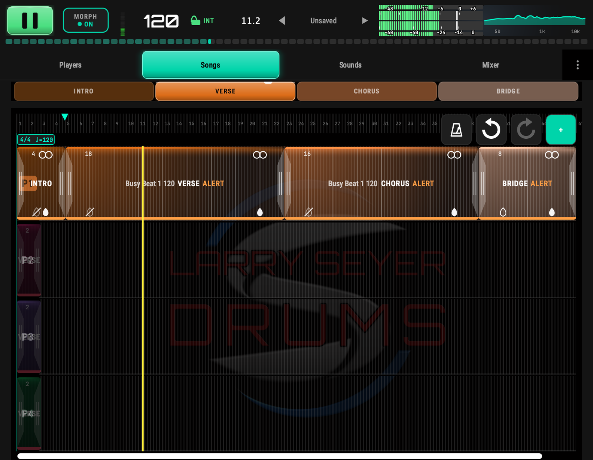

> **Draft for Larry's review — not published.** Temporary quick-start for TestFlight testers until the tutorial videos are ready. App version **0.94.0**.

## Quick Pick: playing in seconds

Quick Pick is the first screen after the splash, and it's the fastest way to hear the instrument. Choose a beat, choose a player preset, and you're playing.

There are ten beats and ten player presets, so you have a hundred pairings. The beats are:

- Basic Beat
- Buyoun
- Push Beat
- Busy Beat 1 (this is **Busy Beat One**, the example I use throughout)
- 60's Soul
- Shuffle Push
- Waltz Straight 1
- Waltz Swing 1
- Latin Beat
- Shuffle

Each one plays as its Verse. Choosing a preset loads its kit. While that happens, the button says “Loading kit…”.

Quick Pick remembers the last pair you chose and the tempo you played it at. The remembered pair is only highlighted until you choose it again. That's different from a Song you have saved.

You can reopen Quick Pick from the three-dot menu or with the Q key. Close takes you to the full app.

If you have a MIDI controller, there is a Quick Pick MIDI channel so you can change slots from any screen.

To save your own beat or preset into a slot, right-click or press and hold, then choose “Save … here” or “Restore factory …”.

A note on names: the final ten player presets are still being finished, so some labels you see in this beta may still be placeholders (for example “Player”, “VelMods” or “Reverb”). The beats themselves are in place, including Busy Beat One.

On iPhone and iPad the layout follows the screen: in portrait, beats are on the left and presets on the right; in landscape, beats are the top row and presets are the bottom row. The heading over the presets may say **Kits** on screen. Those are the player presets.

The iOS AUv3 window opens on Quick Pick. See [Using the Plug-in in a Host](12-using-the-plugin.md).

> **Screenshot needed:** Quick Pick on an iPhone in portrait, same selection, so the side-by-side layout is clear.

## Your first groove from an empty song

Once you've heard Quick Pick, try building a short song of your own. This is the first thing I want every tester to do.

1. From the three-dot menu, choose **New Song**. You'll get Player 1 on, 120 BPM, energy at Normal, and an empty timeline.
2. Open the **Songs** page. You'll see Player 1's pill row, and on the side (or nearby, depending on the device) the **pill pool** — the pile of phrases you can drag in.
3. In the pill pool, pick the style **Busy Beat 1** in Player 1's column.
4. Drag an **Intro**, then a **Verse**, a **Chorus**, another **Verse**, and a **Bridge** onto Player 1's pill row. The first pill on an empty lane starts at bar 1 and sets the tempo from the style. After that, a pill lands where you drop it. Gaps are allowed; a gap is silence for that player.
5. Press **Play** and listen. Tap a phrase tab to jump to a section.
6. Turn on **Post-Fill** on the Verse (the bottom-right corner of the pill) and listen to the fill into the next section.
7. Change one pill's energy and hear how the same notes feel different.
8. Use **Save As…** to put the song into a bank slot and give it a name.

**Save is what makes an edit permanent.** If you only close the editor or switch songs without saving, you can lose the work you just did.

When you want a quick thrill, play the same arrangement at **Chilled**, then at **Energetic**, using the energy row.

On a Mac or iPad you drag with the mouse or trackpad (or a finger on iPad). On iPhone, press and drag. An upright iPhone shows a timeline per player; in compact landscape you'll use the P1–P4 launcher.

You'll find the rest of the arranger — pill corners, lifts, banks, launching sections live — in [Songs: Arranging](06-songs.md).

---

[Previous: Getting Started and Getting Sound](02-getting-started.md) · [Index](index.md) · [Next: Players](04-players.md)
