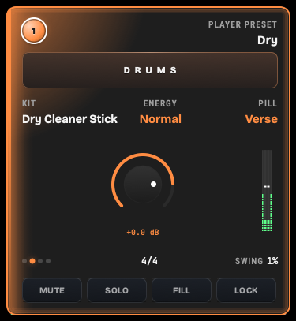

> Temporary quick-start for TestFlight testers until the tutorial videos are ready.

## The player card

The Players page is four cards, one for each drummer. You can show them as a 2×2 grid, four across, or a compact strip. In this beta, all four players and all patterns are available -- nothing here is locked or held back for testers.

**You select a player by tapping its level meter** on the card. Tap the meter again to unselect it. When no player is selected, the energy row belongs to the whole song. When one is selected, energy changes can be aimed at that player. A selected card gets a white ring on its badge.

Each card has:

- A **badge** with the player number. It's on or off. Off shows a slash; tap the number to turn the player on.
- **Player Preset**, **MODE**, **Kit**, **Energy**, and **Pill** (a readout; it says “No pattern yet” until that player has a pill).
- A **volume** knob with a dB readout and a peak/LUFS meter. This is also the level meter you tap to select the player.
- A **groove row** with beat dots, the time signature and Swing. The iPhone card does not have this row; on iPhone, set Swing in the Energy Profile editor instead.
- **Mute**, **Solo**, **Fill** and **Lock**.
- A **voice meter** along the bottom edge of the card.

The card is a remote control. It shows the same state you'll see on the Songs, Sounds and Energy views.

On a Mac or iPad you can set a player's colour with C, or assign random colours with Option+C. Those keys are not on iPhone unless an external keyboard is attached.

## Playing the card live

**Fill** plays a fill from the next beat to the bar line. If you press it in the last beat of the bar, you get the whole next bar. The button blinks slowly until the fill starts.

- Repeated manual presses chain fills together.
- A manual press does not replace a Song fill that is already armed or playing.
- Fills follow the pill's feel and energy.
- The factory **Asleep** energy level is silent, so it plays no fill. “Asleep” isn't a hard-wired mute: if you edit that level so it makes sound, fills can play, and if you edit any level to full silence, fills are suppressed.

**Drum solo:** double-click Fill, or press and hold it. The button flashes fast. A Song fill that arrives during the solo raises the solo's build. **To end the solo, press Fill again.** That latch is a different thing from Lock.

**Mute** affects only that player. **Solo** is additive — you can solo more than one player.

On a Mac or iPad keyboard, hold Ctrl+S for Solo In Front: you hear that one player while the key is down.

## Lock

**Lock** freezes the player's preset, mode, kit, energy, pill and swing. It also disables the card's volume knob and the Fill / solo gestures on the card.

**Mute and Solo stay live** after you lock, so you can still bring a player in or out during a performance. A MIDI Fill (control change 21 on that player's channel) still triggers a fill, even when the card's Fill button does not.

If you're setting up for a gig, lock only after you've confirmed Mute, Solo and any MIDI fill control still do what you need.

## Player presets

A player preset is one tap that brings back a complete player sound and mix. It restores the kit, the channel strips, the sends, EQ, compressor, bus tape, and that player's reverb and delay returns.

It restores **sound and mix, and leaves Energy alone.** Energy stays with the song.

The picker is grouped as Stick, Mallet, Rod, Combo, Synths and User Player Presets. A green check marks the current preset.

There is a tick box, **Also Load Master Fader, Effects and Trim** (“Every Player Hears It”). It's one switch for the whole app. When it's on, loading one player's preset also changes the master that every player goes through, so you'll hear that change on the other players too.

Save versus Save As works the way it does everywhere: Save is for your own items; Save As makes a new one. The name on the card belongs to the song. It stays “Default” until you load or save, and a rename follows everywhere.

You can share a preset as a `.drums-bundle` and open it on another device.

> **Screenshot needed:** The player-preset accordion open on a card, with one preset checked, Pretty Shuffle audible in the description if the UI shows the song or kit name.

## Four drummers at once

Turn on Players 2, 3 and 4 from their badges. Each player gets its own column in the pill pool, its own style and its own pill row on the Songs page, plus its own kit, mixer and returns.

The four players share **one conductor** — the song's meter and tempo — but each can have its own pattern meter. That's a deeper topic in the Songs chapter; for a first test, keep everyone in 4/4 and give each player a different part.

A good first stack: Pretty Shuffle on Player 1 with **Dry** (a Stick kit), a second player on a **Rod** kit adding a ride or tom part (that's the Rod sound itself, not brushes), and a third player on a half-time feel. Mute, solo and volume let you bring them in and out. On a keyboard, the arrow keys move to the previous or next player.

On an iPhone in compact landscape, the cards become a strip and you open a player's lane when you need it.

> **Screenshot needed:** Four players on, with Player 1 on Pretty Shuffle and at least one more player showing a different kit or part.

---

[Previous: Quick Pick and Your First Groove](03-quick-pick-and-first-groove.md) · [Index](index.md) · [Next: Energy and Feel](05-energy.md)
