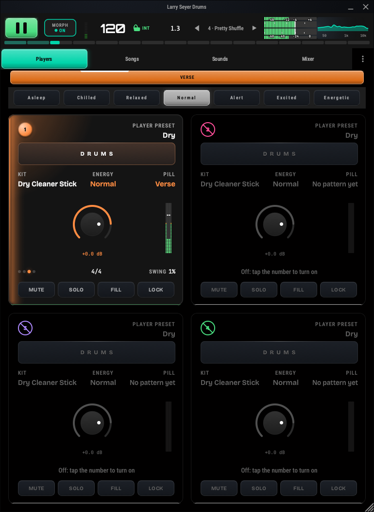
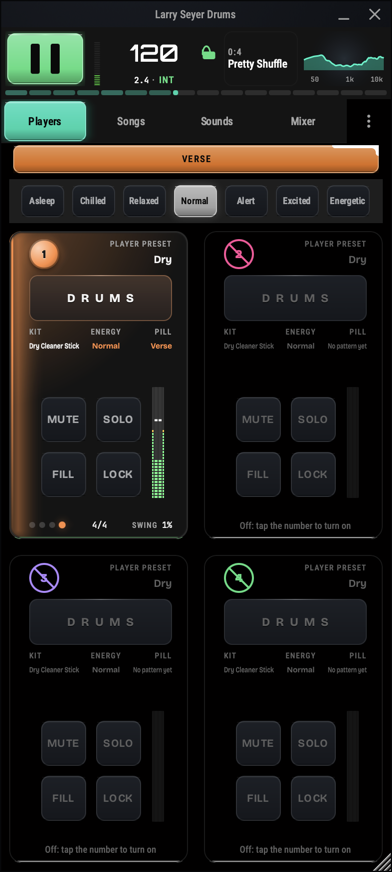
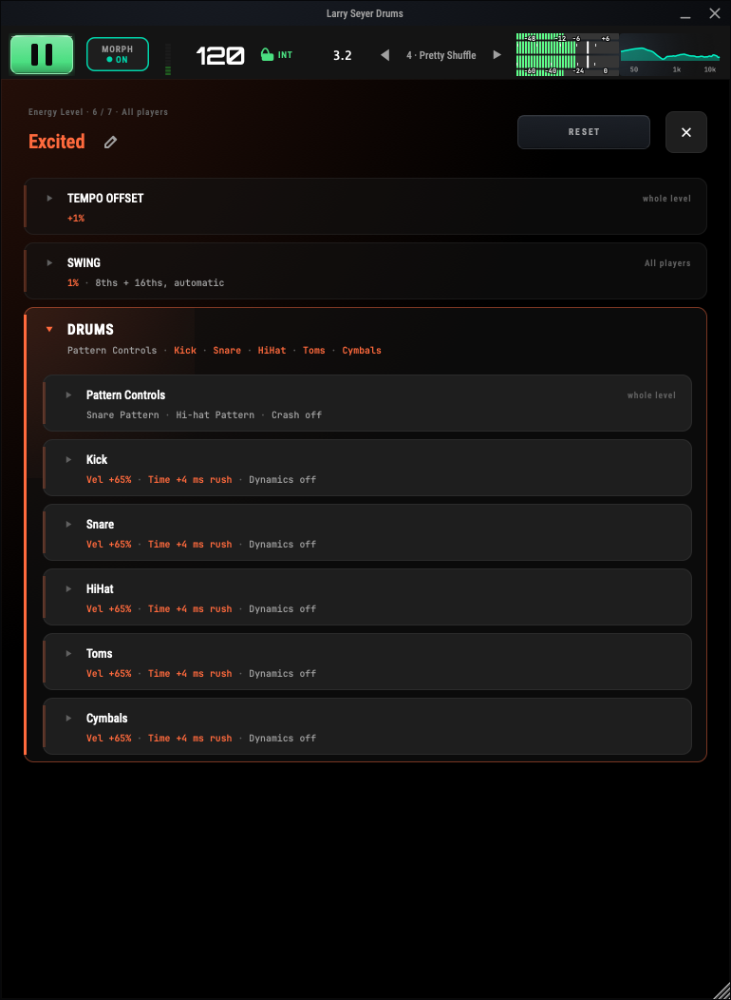
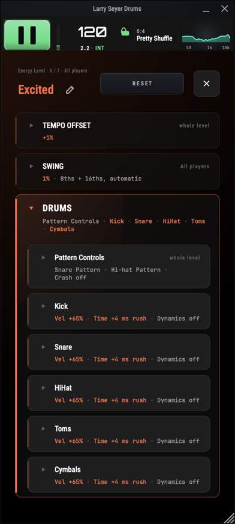

> Temporary quick-start for TestFlight testers until the tutorial videos are ready.

## The seven energy levels

Energy is how a drummer leans into a part without you rewriting the notes. The row is:

**Asleep · Chilled · Relaxed · Normal · Alert · Excited · Energetic**

Try the same eight bars of Pretty Shuffle at Chilled, then Normal, then Energetic. The pattern stays the same. The playing does not.

The factory **Asleep** level is silent, but the name isn't a hard-wired mute. If you edit Asleep so it makes sound, it will play. If you edit any level down to full silence, fills are suppressed on that level, just as they are on factory Asleep.

::: mac

:::

::: iphone

:::

## Who the row belongs to

- **With no player selected**, the row sets the song's global energy. Each pill still uses the level stored for it. A tempo offset on a level applies only when the app owns the clock — not when it's following a host or Ableton Link.
- **With a player selected** (tap that player's level meter), a tap on the row reaches every pill that player already has. Each pill remembers its own answer for that level, so a per-pill choice you made on the Songs page survives.
- A **deliberate re-tap** of the level that's already lit resets the pills in scope so they follow it again. If you've made one pill an exception, leave, come back, and re-tap to clear that exception.
- With nobody selected, a tap moves the global level and every **unlocked** player's own level. A locked player keeps its level. A per-player tap never moves the song's tempo.

You can also set a single pill's energy from the pill's menu or from the Energy field on the card. Keys 1 through 7 set the selected pill's energy when a keyboard is attached.

There's an Accessibility switch, **Show Energy-Modulated BPM During Playback**, if you want to see the offset tempo while it plays.

## The Energy Profile editor

Double-tap a level, or use the pencil in the Pattern Editor, to open the editor. A Reset to Factory chip is right there if you want the stock behaviour back.

Who you're editing follows the card selection: all players, or the one player you've selected.

The editor is an accordion: **Tempo Offset**, **Swing** and **Drums**, with one section open at a time. Closed headers still show their values.

- **Tempo Offset** runs from −20% to +20%, and only when the app is the sync master.
- **Swing** is 0–100%, and can swing 8ths, 16ths, 32nds or quarters. Double-click a control to reset it. This is different from a pill's Triplet feel, and different from compound counting such as 6/8 in 2 or in 3. Fills follow the feel.
- **Pattern controls** let you change what the drums do at this level: snare mode (Pattern, Stick, Snare, Rimshot), hi-hat mode (Pattern, HiHat — play the ride as a closed hat — or Ride — play the hat on the ride), and the backbeat crash.

A useful experiment: turn Pretty Shuffle's Excited level into a ride-driven, rimshot chorus feel, then switch between Normal and Excited.

Energy definitions **belong to the Song**. Editing them changes this song, not a global default. A New Song starts from the factory levels. To reuse a set of levels, export or import them (Import/Export → Energy) or copy them into another song. Each level button has a menu for Rename (up to 40 characters), Colour, Copy Settings, Paste Settings, Paste Settings to All Levels, and Reset to Factory.

::: mac

:::

::: iphone

:::

There's more depth here — kick, snare, hat, toms and cymbals each have their own shaping, including a feature called Morph on the toms, and a way to send a cymbal to Bells. The tutorial videos will go drum by drum. For testing, the row plus the editor is enough to find problems and hear whether energy feels right.

---

[Previous: Players](04-players.md) · [Index](index.md) · [Next: Songs: Arranging](06-songs.md)
