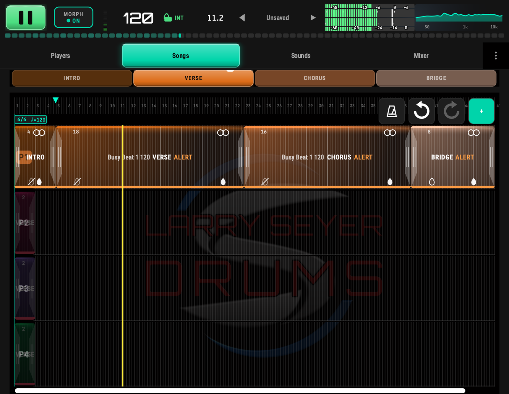
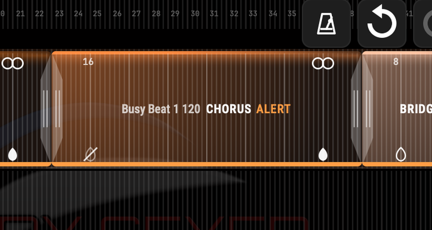

> **Draft for Larry's review — not published.** Temporary quick-start for TestFlight testers until the tutorial videos are ready. App version **0.94.0**.

## A tour of the Songs page

The Songs page is the arranger. Four **player pill rows** (P1 through P4) run as timelines. Beside them is the **pill pool**: one column per player, showing that player's mode and style. **Blank 120** is a silent style for building from nothing.

Along the ruler you'll find **Click**, **Undo**, **Redo** and **+** (a new blank pattern). The **edit cursor** is the green triangle. The **play cursor** is the yellow line. Under the bar ruler is the meter and tempo strip.

Follow-scrolling keeps the playhead in view while you play; if you scroll yourself, your scroll wins. You can zoom with pinch, the scroll wheel, or Z and Shift+Z on a keyboard.

With nothing selected in a pool column, you're browsing styles. With a pill selected, changing the column restyles that pill. You can mix styles in one song. Tap a pill's bar count to type a new length, and use the section-name picker to rename it.

On iPhone the page has three useful layouts: upright (a timeline per player), landscape, and a compact P1–P4 launcher.

## Placing, moving and resizing pills

Drag from the pill pool onto a player's row. Pills snap to bars.

- **The first pill on an empty lane starts at bar 1.** After that, a pill lands exactly where you drop it.
- **Gaps are legal.** If you leave space, that space plays silence for that player.
- **If pills collide:** the dropped pill keeps its landing. An earlier pill it overlaps is clipped back to the drop point. Later pills it overlaps ripple forward.

Move pills by dragging, or nudge them with the left and right arrow keys. The same landing rules apply.

You can resize in three ways: drag a single edge; type a new length (that numeric length stops at the next pill); or resize a group from the edge, which has its own adjacency rules.

Delete or Backspace removes a pill. Double-click an empty gap to select it, then Command+Delete (or the matching menu item) closes the gap.

## Pill corners

Each pill has four corners and a mute:

- **Top left:** the bar count.
- **Top right: Loop.** On Player 1, the whole song repeats that section. On Players 2 through 4, only that pill loops.
- **Bottom left: Pre-Fill.** On the first pill, this adds a pre-roll bar. That's different from the count-in you get when recording into the Pattern Editor.
- **Bottom right: Post-Fill.**
- **Top centre: Mute.** A muted pill sends no MIDI and exports silent.

Fills follow the pill's energy and feel. The fill tint on a pill is not the same indication as the card's manual Fill button.

On a keyboard: L for loop, P for pre-fill, F for post-fill, and Command+M for mute.

A good test: loop the Busy Beat One Chorus, then release it into a Post-Fill.

One caution for testers: a few factory styles still have fills I'm A/B'ing. Please don't use **Rock 130**, **Rock Shuffle 125**, **Pretty Shuffle** or **Texas Blues Jam 115** as your fill examples for now. Busy Beat One is the safe choice.

## The pill menu and working with many pills

Right-click a pill, or press and hold it, for the pill menu: Edit, Mute, Move, Copy, Duplicate, Paste, Split (Option+S), Delete, Delete with Ripple, Rename (Command+R), Export MIDI, Energy Levels, Feel (As Written or Triplet), Playback Speed (1/4x to 4x — the pill keeps its length), and Colour (Shift+C).

You can rubber-band a group of pills, or Select All Pills (Command+A). The multi-select menu can mute, move, copy, duplicate, paste, combine, delete, rename or export the group. **Combine** (Command+G) joins pills when the app is willing; it will decline when that wouldn't make sense.

You can also insert measures at the edit cursor (Command+I) and work with a time selection. Undo and Redo are one history for the whole app.

## Meter, tempo and lifts

Meter tags live in their own strip under the ruler. Long-press or right-click to insert a meter or set a tempo. Double-tap bar 1's tag to type the opening meter. When the app is a plug-in on Host Sync, it takes the host's tempo map instead.

A **lift** is a small drummer pickup into the next bar. Double-tap the ruler to place one (you'll see a caret). A lift is played on the groove's own voice and follows the pill's energy. You can't place a lift before bar 1, and a pattern with no snare or stick won't play one.

App Settings has **Auto Lifts** if you want them generated on a phrase length, with a short recipe for what the lift plays. From a controller, control change 18 places a lift.

Try Busy Beat One with Auto Lifts every four bars, then compare that with a couple of hand-placed lifts.

## Playing a song live

When the transport is stopped, tapping a pill or a phrase tab jumps there. When it's playing, the tap is **armed** — a white ring blinks — and the jump happens according to **Launch Quantization**: Immediate, Next Beat, Next Bar, or End of Pill. Tap again for the end of the bar; tap the playing pill to cancel.

**Auto Fill on Pill Change** can throw a fill as you jump. You can loop a section until you're ready, then release it. Stop returns both cursors to the start of the current pill.

On iPhone, the phrase tabs are the main live surface.

## Songs, banks and set lists

Songs live in **banks** of slots **0 through 99**. The slot number is also the Program Change number, so a controller can recall a song by that number.

From the Song menu you can New, Save, Save As, Rename, Load, Export and Delete. The bank grid is one column of a hundred slots; tap to load or save. A per-slot menu includes **Lock** — a locked slot has a badge and can't be saved over or deleted.

You can have up to 127 banks. Use the previous/next arrows, the add-bank button, and the bank menu (jump, add, rename, delete). The song stepper only steps to occupied slots and never wraps across banks. Tap the name for the bank list; hold the name to rename the song in place. **Find Song** (Command+F on Mac and iPad) searches across banks.

At startup, the standalone app reopens the last slot you were in.

A good test: make a new bank, put three short songs in it, and step through them while the app is playing.

---

[Previous: Energy and Feel](05-energy.md) · [Index](index.md) · [Next: The Pattern Editor](07-pattern-editor.md)
