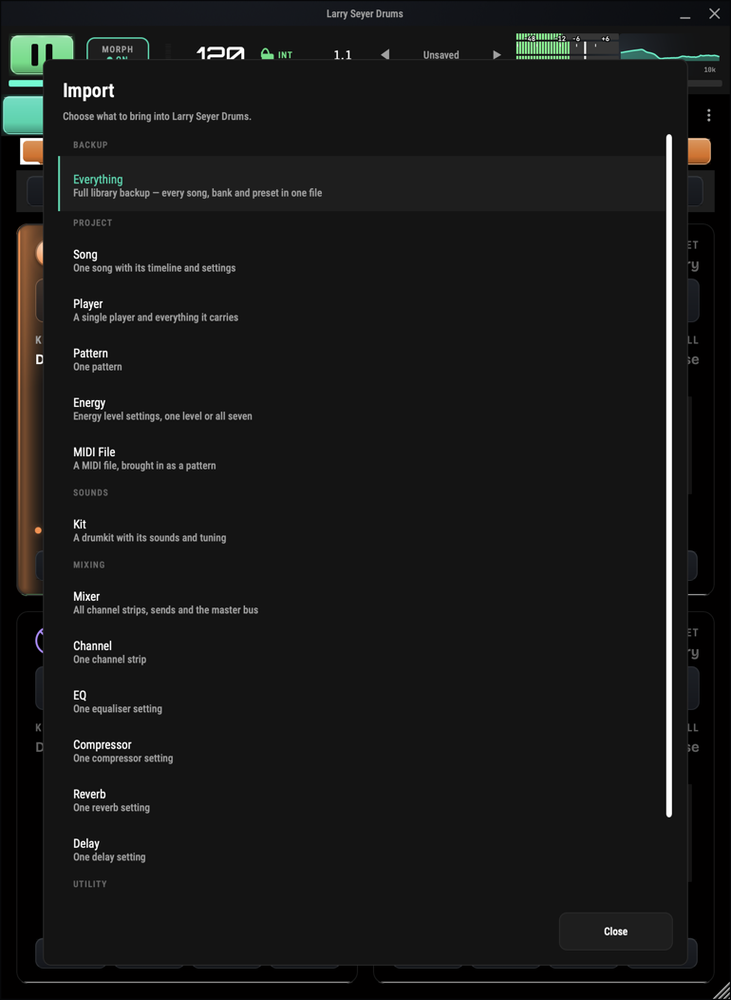
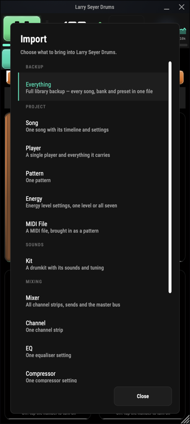

> Temporary quick-start for TestFlight testers until the tutorial videos are ready.

## Import a MIDI file and generate a style

You can turn a drum MIDI file into a playable Larry Seyer Drums style.

::: mac

:::

::: iphone

:::

1. Open **Import → MIDI File**.
2. Choose how to read it: **EX** (Larry Seyer Drums' own notes) or **General MIDI**.
3. If the file came from another product, use **Assign this file's drums**. You'll get a row per note, a drum menu, an audition speaker, and saved note maps. The app will tell you if some notes were left out, for example “3 of 14 notes left out.”
4. Name the style. The “Saved as” preview appends the tempo.
5. Set **Feel** to Auto, Straight or Triplet, and Quantize on or off.
6. Import it as a Verse.
7. Watch **Generation Progress**. The app writes an Intro, Chorus, Bridge and fills from your Verse, on this device — nothing is sent off the machine.
8. If you don't like the generated parts, use **Generate Again**.

You can also drag a MIDI file straight onto a pill row or a pool column on a Mac. On iPhone and iPad, import from the Files app. Dragging is still being retested, so if a drag doesn't take, use the Import window and tell me.

## Rules worth knowing

- **Channel 10 is preferred when it's present.** Otherwise the file's own channels are used. It is not “channel 10 only.”
- If the file has no tempo marking, the import uses 120 BPM.
- Very long files are capped.
- Generation needs the transport **stopped**. **Cancel** leaves no partial style.
- Repeated names are numbered. A failed import leaves the source file alone.
- The app will show you how many fills it generated. I don't quote a library-wide fill count here, because the number you should trust is the one on screen.

A good test: import a groove you actually play, listen to the generated Chorus and fills, then generate again and compare.

> **Screenshot needed:** The MIDI import window, mid-assignment or on the name-and-feel step, with a file loaded. No need to show a third-party product name on the file itself.

---

[Previous: The Pattern Editor](07-pattern-editor.md) · [Index](index.md) · [Next: Sounds and a Feature Called Morph](09-sounds.md)
