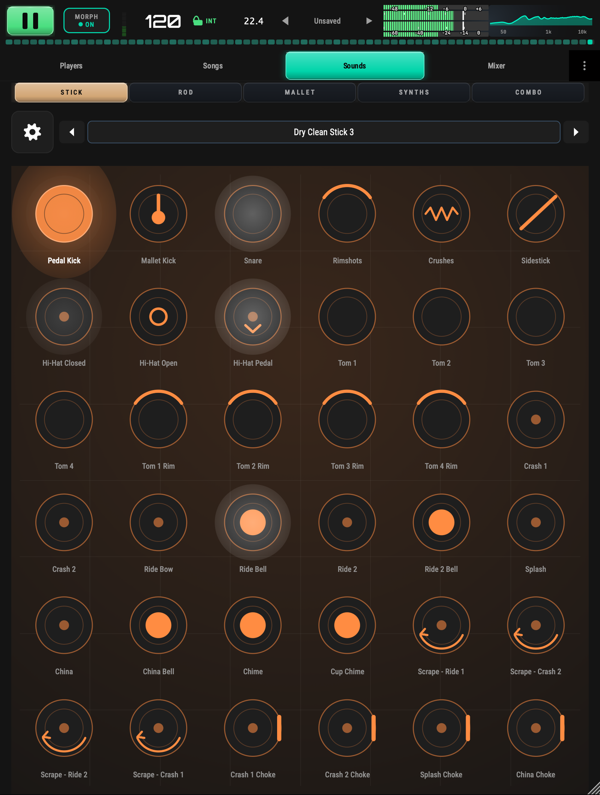

> **Draft for Larry's review — not published.** Temporary quick-start for TestFlight testers until the tutorial videos are ready. App version **0.94.0**.

> **Provisional chapter.** I still plan to rethink the Sounds page once the rest of the app has settled, and some of the synth kits are still waiting on my ear. What follows is how the page works in 0.94.0. If the screen in front of you looks different, the screen is right — please tell me, and use what you see.

## Choosing a kit

Open the **Sounds** page, or use the Kit field on a player card.

Kits are grouped by striker: **Stick**, **Rod**, **Mallet**, **Synths** and **Combo**. “Combo” means a kit that mixes those sources. Step through kits with the ‹ › buttons, or open the chooser, which is split into Factory and User.

While a kit loads, you'll see “Loading kit…”. Tap a pad to hear it and to select it. The 6×6 pad grid lights up as the pattern plays.

A good listen: put Busy Beat One on a Stick kit, then a Rod kit, then a Mallet kit.

Kits are built by swapping sounds from the supplied library. Larry Seyer Drums does not import your audio samples. The one exception is the click, which can load an audio file. A shared kit or player preset carries settings, not the sample recordings themselves.

## A feature called Morph

A feature called Morph blends neighboring recordings so no two hits sound exactly alike.

The **MORPH** chip in the top bar only reports the state: On, Off or Building. Tap it to see which drums are morphing. You don't switch Morph from the chip.

The controls live in **App Settings → Morph**, with four modes:

- **Automatic** (recommended). It turns itself off when the machine doesn't have room.
- **Always On**
- **Always Off**
- **Random**

There's a drums checklist by group: Snare and toms, Hi-hat, Cymbals. The kick always plays plain samples. **Strike Lean** is either “Vary each hit” or “Exact recordings.”

After you change kits you may see “Building the morph for the new kit.”

What actually morphs depends on the device. Computers morph snare, side-stick, toms, hi-hat and cymbals. iPhone and iPad morph snare, side-stick and toms. An upright iPhone hides the MORPH chip; Morph still runs from App Settings.

A clear test: a snare roll with Morph off, then on.

. The kick always plays its plain samples.")

## Building your own kit

Edit a kit from the Sounds page. The Edit workspace has a name, Save / Save As, and a SOUND | TUNE inspector. Each piece can come from Synth, Stick, Mallet, Rod or Combo. A snare brings its rims and crushes with it; the side-stick is separate. You can mix sources in one kit.

Your saved kit lands under **User Kits**. Save versus Save As works as usual; Save leaves the Edit workspace. You can delete, export and import a user kit.

A kit is not the same thing as a player preset. A kit is the sounds. A player preset is the sounds plus that player's mix.

On iPad and Mac you can drag a sound onto a pad. On iPhone, use Browse and the Edit screen.

The TUNE side has six sliders: Tune, Volume, Attack, Decay, Sustain and Release. Tune and Volume act on the whole instrument; the envelope is per articulation. Deeper editors sit behind the menu button: a sample editor (waveform, pan, hold, and an **Output Bus** chooser) and a synth voice editor.

A small, useful test: tune the Busy Beat One snare down a semitone and shorten its decay.

## The synth machines

The Synths tab has machines 1 through 9 (S1–S9 on a narrow phone). One tap loads a whole machine kit. You can also build a hybrid kit, for example a synth kick under sampled drums.

**Synth 3 is being corrected** in this beta, and the other synth kits are still waiting on my listening pass. If a synth kit sounds wrong, it may already be on my list — but I still want the report, especially if it misbehaves, not just if it doesn't sound like a record yet.

---

[Previous: Bringing in Grooves](08-bringing-in-grooves.md) · [Index](index.md) · [Next: Mixer and Effects](10-mixer-and-effects.md)
