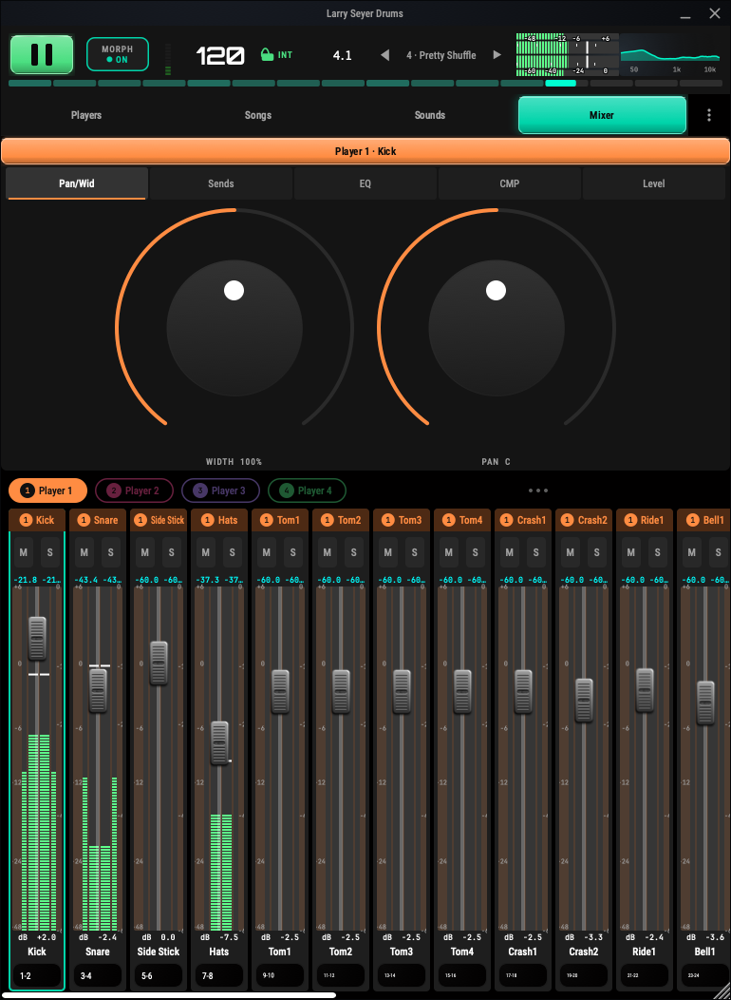

> Temporary quick-start for TestFlight testers until the tutorial videos are ready.

## The mixer

Open the **Mixer** page, or press M. It follows the selected player; tabs at the top switch players. You're always looking at one player's console at a time.

The strips are Kick, Snare, Side Stick, Hats, Tom 1–4, Crash 1–2, Ride 1, Bell 1, Ride 2, Bell 2, Splash and China, then the returns, the player bus, and the master.

Each drum or return strip has a fader, Pan, Width, four sends, Mute and Solo, a peak/LUFS meter, and an **output picker**. Solo dims the M of every other strip. The output picker is an assignment: each drum strip defaults to its own pair, and that only matters when you're on a multi-out route. Output names you see in a host are defaults, not fixed destinations. FX returns default to the main pair, so if you want them on their own tracks you have to assign them.

Channel detail tabs are Pan/Width, Sends, EQ, Compressor and Level. You can drag the split between the strips and the detail panel. The master spectrum can go full screen.

On iPhone in compact landscape you'll get a single row of channel buttons with M and S.

If a return or strip is dimmed with **“Not enough power,”** that's the device's effect budget, not a fault. See [iPhone and iPad](13-iphone-and-ipad.md). Watch the DSP load meter beside Play.

## Linked edits and MIDI Learn

You can select several strips at once (drums, returns or buses — never the Master). When you move a control, the others keep their offsets. On/off controls set the whole selection. A channel that hits the end of travel stops and catches up later.

**Learn MIDI** is on mixer faders in this build. Right-click a strip, or press and hold its name band. A fader binds to a control change on the control channel. Several faders can share a change, and you can bind a group at once. Clear MIDI Binding removes it. There isn't a wider MIDI Learn pane in this beta — just the faders.

## SeyerEQ, SeyerComp, reverb, delay and tape

Each channel can have **SeyerEQ** — up to 32 bands, with shape, slope, frequency, gain and Q, plus stereo placement (L/R and M/S) and several processing modes. There's an analyzer, dynamic EQ, and EQ presets.

**SeyerComp** is the compressor. There's also **Simple Comp**. Which one you get depends on what the device can afford; both default to off. If the device has reached its SeyerComp capacity, a compressor you switch on runs as Simple Comp and says so on the panel.

SeyerComp has a Morph dial across eight voices (Clean, FET, Opto1, Opto2, VarMu1, VarMu2, VarMu3, Combo). That's the compressor's own Morph, not the drum-sample feature called Morph.

**Reverb and delay** live on the returns. They have their own Morph, Time/Tone and Output groups, and you can save a default with the song. Extra reverb returns the device can't afford show **“Not enough power.”** One player's reverbs always run.

**SeyerTape** can sit on the master and on player buses. On a Mac, tape is always available. On iPhone and iPad it depends on device power. The panel will say “This device is not fast enough for the tape” or “This device runs the tape on the master bus only.” On some devices master tape isn't granted automatically, but you may still be able to switch it on if the song is light enough.

A clean test: Pretty Shuffle with no added reverb, then with a short room, then a hall, letting each tail finish; then, on a machine that can afford it, 15 ips tape with a tape stop at the end.

## The master, outputs and audio export

The master strip has trim, a limiter, and mixer presets for recalling a whole board.

**Outputs** are in App Settings → Outputs. **Routing Mode** is Auto (Recommended), Force Stereo, or Force Multi-Out. **Rescan Outputs** asks the audio device again in the standalone app.

That's enough for a stereo mix in the app. If you're using the plug-in and you want separate outputs, read [Using the Plug-in in a Host](12-using-the-plugin.md) before you change the mode. The steps in a host are a little different, and this beta still has one extra step on a running Mac plug-in.

**Audio export** is Export → Audio. You can render the master mix, a player, all players as stems, a player bus, or all buses. Player sources always render as separate stems. Formats include WAV and AIFF at 16, 24 or 32-bit float, FLAC up to 24-bit, and OGG. You can export the whole song or selected pills. “Marked section” is not ready in this build, so you won't find a working marked-region export yet.

A few honest limits:

- A player stem is that player's bus with its returns, before the master. Summed stems need not equal the master mix, because the master has its own processing.
- The click is never exported.
- Export renders the arrangement. It does not record live input.

On a computer you choose a stems folder. On iOS, a multi-file share sheet is used.

---

[Previous: Sounds and a Feature Called Morph](09-sounds.md) · [Index](index.md) · [Next: Tempo, Sync and MIDI](11-tempo-sync-and-midi.md)
