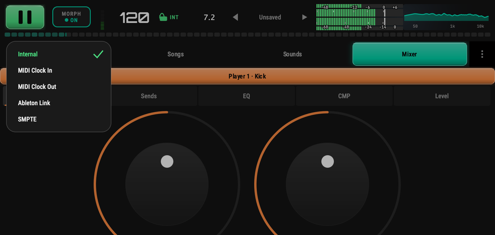

> **Draft for Larry's review — not published.** Temporary quick-start for TestFlight testers until the tutorial videos are ready. App version **0.94.0**.

## Tempo, the click and who owns the clock

Tempo can be tapped (it starts averaging from the third tap, using the last four), typed if you hold the control, or dragged. The range is 30 to 300 BPM. The ` key also taps tempo.

The **padlock** next to tempo is the clock. An open lock means you set the tempo. A closed lock means the app is following a clock. Shift+P sets the clock source.

The sources you'll see are **INT**, **M-OUT**, **HOST** (plug-in only), **M-IN**, **Ableton Link** and **SMPTE**.

An energy level's tempo offset applies only when the app owns the clock.

The **click** has a button on the Songs ruler, and a full page in App Settings → Click: beat-1 and other-beat sounds, Load Audio File, Level, Output, and Listen to one bar. Count-in for recording is separate from a first-pill Pre-Fill.

## Syncing, including Ableton Link

**Ableton Link** is how you lock tempo and phase with other apps and devices on the same network. Always use the full name; the source tag reads ABLETON LINK. Ableton Link shares tempo and phase. **Start/stop sync is a separate option**, so turning on Ableton Link does not by itself start and stop the other device.

The first time you use it, iOS will ask for local network access. macOS 15 and later asks the Mac app too. Please allow it, or Link can't find the session.

You can also sync with MIDI Clock in and out (with Song Position Pointer), Host Sync inside a plug-in, and SMPTE timecode from the audio input. SMPTE follows **position** at Larry Seyer Drums' own tempo; the timecode itself doesn't carry a tempo map. Microphone permission is required for SMPTE.

Each sync path has an offset in App Settings, ±500 ms, which you can adjust by ear while playing. A plus value puts this app ahead.

A good test: two devices on Ableton Link, both playing Busy Beat One, locked together.

## Playing the sounds from pads, an e-kit or a keyboard

You don't need a pattern at all. Incoming notes can play the selected kit directly.

1. Switch on the MIDI input (per-port switches on iOS; Audio settings on a computer).
2. Set **MIDI Input Channels** so the right channels can trigger drums, and set the control channel.
3. Set **MIDI Input Layout** to **GM**, **EX** or **E-Kit**. A fresh install starts on GM. If your settings are older, you may open on EX — check it.
4. Notes play every player assigned to that channel. By default that's Player 1 on channel 1 through Player 4 on channel 4. Notes on the control channel, the Program Change channel or the Quick Pick channel never play drums.

The hi-hat pedal is control change 64. The mod wheel (control change 1) is special: the first time a player hears it, it takes over that player's hi-hat openness for the rest of the song. It isn't passed through to the sampler as a generic modulation.

You can pair a Bluetooth MIDI device from the app. In the standalone app, the virtual “Larry Seyer Drums IN” and “OUT” ports are available. A port can't be both input and output, and the app ignores its own notes coming back, so you don't get a feedback loop.

Watch the inbound MIDI light in the top bar. If it doesn't flash, the notes aren't arriving.

## Controlling the app from MIDI

Program Change recalls song slots 0–99 in the active bank. On a player's own channel, control change 21 is Fill, 18 is Lift, and 70/71 are mute and solo. Mixer faders can be learned, as described in the Mixer chapter.

There's a much fuller control table for people who are wiring a show. If you're doing that in this beta and you need the complete map, ask me and I'll get it to you; I don't want to turn this quick-start into a MIDI implementation chart.

## MIDI out, and a word about OSC

The app can send its players' notes out to another instrument, and you can export a MIDI file as EX (Larry Seyer Drums' own map) or GM (the closest General MIDI drum sounds). Use EX when you want the notes to come back as the same drums. A GM file is a translation; for example, some toms land on the closest GM tom, not always the same identity.

In a host, the host is what routes MIDI out.

**OSC** is also available if you want to control the app from another device or script. It's in App Settings → OSC Control, enabled by default, on port 9100 (replies go to the next port). That's enough to know it exists. If you're testing OSC and you need the command list, ask me for it rather than guessing at addresses.

---

[Previous: Mixer and Effects](10-mixer-and-effects.md) · [Index](index.md) · [Next: Using the Plug-in in a Host](12-using-the-plugin.md)
