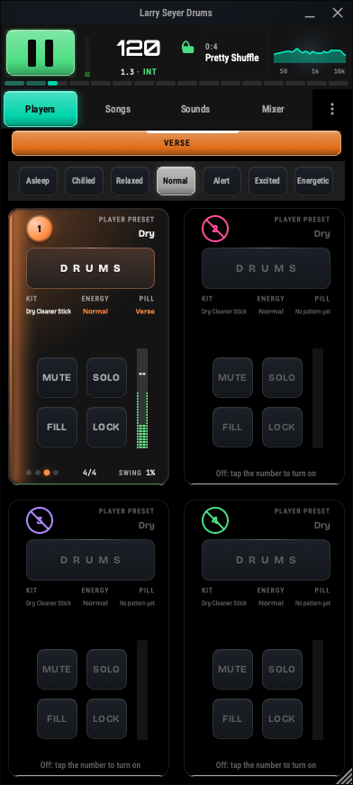
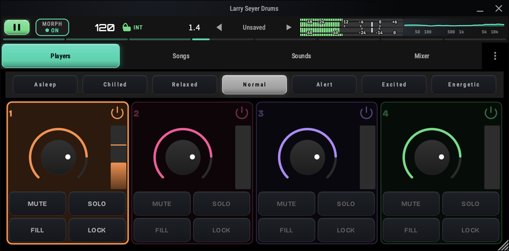
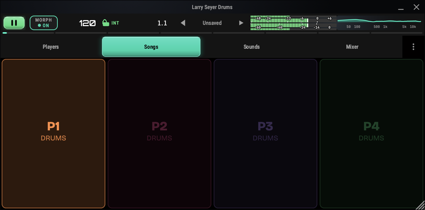

> Temporary quick-start for TestFlight testers until the tutorial videos are ready.

On iPhone and iPad, Larry Seyer Drums is one app that is both the standalone instrument and the AUv3 plug-in. This chapter is about using the app itself on those devices. Using it inside a host is in [Using the Plug-in in a Host](12-using-the-plugin.md).

iPad layouts match the Mac screenshots in the rest of this guide. The pictures here are the iPhone layouts.

## Layouts and everyday gestures

The app rotates with the device. The Players, Songs, Sounds and Mixer pages each have a tighter layout in portrait and a wider one in landscape. On an iPhone in compact landscape, player cards can fold down to a strip, and the Songs page can use a P1–P4 launcher instead of four full timelines.

A few iOS niceties that testers should try:

- **Shake to undo**, and haptics. Shake-to-undo during playback is an Accessibility option.
- **Lock Screen** play and stop controls.
- Audio can play **on top of other apps** — the audio session mixes with them.
- **Bluetooth MIDI** and wired MIDI both work from the standalone app.
- Buffer size on the iOS Audio page is 128 to 1024.

Folding-phone layouts are supported in the code, but I have not presented them as verified on real hardware. If you're on a folding phone and something looks wrong, that's useful to know.

## Device power and the load meter

Most iPhones have limited processing power, and Larry Seyer Drums can use a lot of it. Multiple compressors, tape, reverbs and Morph all cost processing. **The app still works.** How many effects you can run at once depends on the device, not on a missing feature.

When audio starts, and again when the sample rate or buffer size changes, the app measures what this device can afford. There is no model list. On iPhone and iPad it grants effects in this order:

1. The first SeyerComp (always)
2. Tape on the master
3. Up to five SeyerComps in all
4. Tape on the four player buses
5. The other players' reverbs

If a step doesn't fit, it is skipped, and the next cheaper one is still tried.

What you'll see when a device is full:

- **SeyerComp** past the limit runs as **Simple Comp**, and the panel says “Simple Comp is running because this device has reached its SeyerComp capacity.”
- **Tape** shows “This device is not fast enough for the tape” or “This device runs the tape on the master bus only.” On some devices master tape isn't granted, but you may still switch it on if the song is light enough.
- **Reverb returns** the device can't afford are dimmed with **“Not enough power.”** One player's reverbs always run.

The **DSP load meter** beside Play is the thing to watch. It climbs from green toward red as load nears the limit, and it flashes red after a dropout.

On a Mac the same check runs, tape is always available, and everything normally fits.

These budgets were calibrated on an older-phone class of device and are still marked provisional in the code, so if your iPhone or iPad feels over-limited or under-protected, please include the model, iOS version, sample rate and buffer size in the report.

.")

> **Screenshot needed:** A compressor or tape or reverb panel showing one of the “not enough power” or Simple Comp messages, on a real device.

## External keyboards

An iPhone or iPad with a USB or Bluetooth keyboard uses the **same shortcuts** as the Mac. See [Keyboard Shortcuts](14-keyboard-shortcuts.md) for the essentials and for a few iOS exceptions (function keys, non-US number-row chords, and a couple of keys the system keeps for itself).

---

[Previous: Using the Plug-in in a Host](12-using-the-plugin.md) · [Index](index.md) · [Next: Keyboard Shortcuts](14-keyboard-shortcuts.md)
